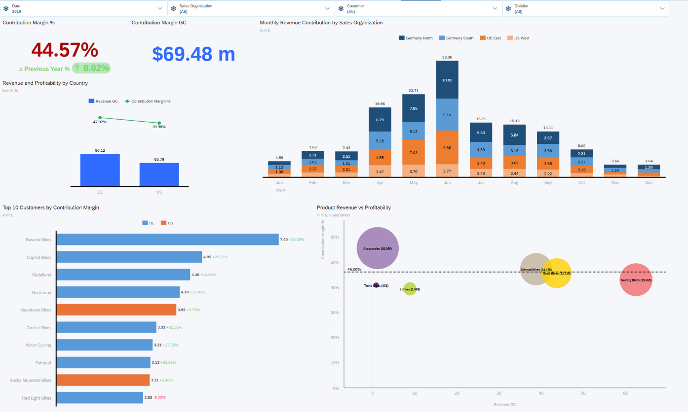

# Sales Performance and Profitability in SAP Analytics Cloud

Individual academic dashboard · Ngee Ann Polytechnic · Intelligent Enterprise Systems · Semester 3 folder, 2026 coursework

## Business problem

Help a sales manager identify which countries, customers and product categories drive contribution and where profitability needs investigation in the Global Bike teaching case.

## Methodology and tools

Built a SAP Analytics Cloud dashboard using the teaching case's sales model. A top-down layout connects contribution KPIs with country performance, monthly sales, customer contribution and product revenue versus margin. Date, sales organisation, customer and division filters plus linked analysis support investigation. The report explains the choice of visuals and business actions.

## Key findings from the submitted report

| Measure | Reported value / finding |
| --- | --- |
| 2019 contribution margin | 44.57%, below the internal case target of 46% |
| 2019 contribution amount | Approximately $69.48 million |
| Germany | Approximately $90.12m revenue; 47.92% contribution margin |
| United States | Approximately $65.79m revenue; 39.98% contribution margin |

The report recommends investigating the US margin, preparing capacity for the April–June increase and reviewing high-revenue products below target. These are case-study recommendations, not implemented business improvements.

## Files and access

- [Original report narrative](reports/submitted-report.md), extracted to Markdown with student number and institutional tenant URL removed.
- `assets/profitability-dashboard.png`: unchanged dashboard image extracted from the report.
- [Validation and missing artefacts](docs/VALIDATION.md).

The original SAC story/export and source model were not present in the allowed folders. Interactive reproduction requires an authorised SAC tenant, the Global Bike teaching model and appropriate story permissions. The screenshot is a static preview; it is not an interactive hosted dashboard. No institutional login or tenant URL is published.

## Limitations and finance relevance

Contribution margin is not the same as net profit or gross margin. The 46% line is an internal case target, not an industry benchmark. Sales seasonality and regional differences do not prove their causes; promotion, stock, price and cost data would be needed. This academic project demonstrates KPI interpretation and management reporting useful for finance operations and analytics.
